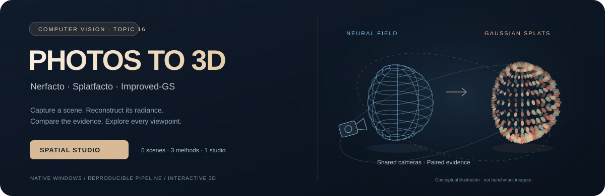
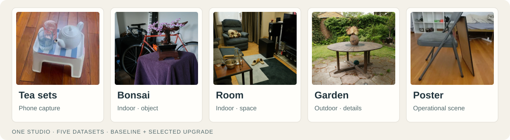
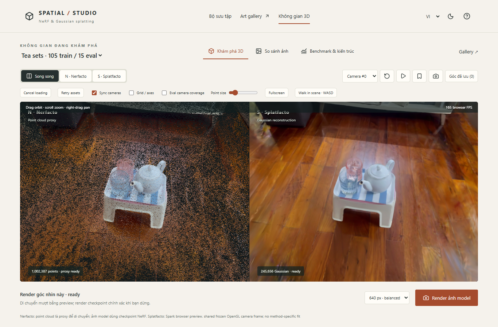
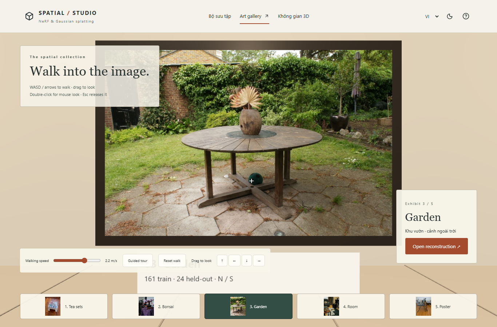
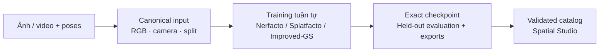

<p align="center">
  
</p>

<h1 align="center">Photos to 3D · Spatial Studio</h1>

<p align="center">
  <strong>Từ ảnh chụp nhiều góc nhìn đến một không gian có thể khám phá.</strong><br/>
  Nerfacto · Splatfacto · Improved-GS
</p>

<p align="center">
  <a href="#bo-suu-tap">5 datasets</a> ·
  <a href="#kien-truc">Kiến trúc</a> ·
  <a href="#ket-qua">Kết quả</a> ·
  <a href="#chay-ui">Chạy UI</a> ·
  <a href="#cai-dat">Cài đặt</a> ·
  <a href="#repository-map">Thư mục</a> ·
  <a href="setup_full_command.md">Runbook</a>
</p>

Project Computer Vision so sánh **neural radiance field** và **3D Gaussian Splatting**, sau đó nghiên cứu bản Gaussian cải tiến trên Tea và chuyển sang các scene còn lại. **Spatial Studio** đưa model 3D, ảnh đối chiếu và số đo vào cùng một trải nghiệm.

| Khám phá không gian | Kiểm tra chất lượng | Đọc kết quả nghiên cứu |
|:---|:---|:---|
| Gallery 3D, orbit/zoom, camera sync, presets và bookmarks | GT / baseline / upgrade, wipe, ROI và ảnh held-out cùng camera | PSNR, SSIM, LPIPS, chi phí, kết quả theo view và các thí nghiệm |

<a id="bo-suu-tap"></a>

## Năm cảnh · từ vật thể nhỏ đến không gian thực



*Ảnh đại diện từ dữ liệu thực, crop để trình bày. Cả năm scene đã có baseline, bản Gaussian upgrade, ảnh evaluation và export 3D.*

<details>
<summary><strong>Xem không gian 3D và art gallery trong Spatial Studio</strong></summary>





Nerfacto trong viewport là point-cloud proxy để điều hướng; ảnh neural chính xác lấy từ checkpoint. Các screenshots này minh họa workspace baseline và gallery.

</details>

<a id="kien-truc"></a>

## Kiến trúc · từ dữ liệu đến trải nghiệm 3D



**Frontend React/Three.js/Spark** xem ảnh đã lưu và Gaussian/point-cloud exports. **HTTP backend** phục vụ catalog và artifacts, không import Torch; render checkpoint tại camera mới chạy trong **GPU worker riêng**, dùng chung khóa GPU. Chọn scene hoặc mở UI không train lại model.

<details>
<summary><strong>Ba phương pháp và phần nghiên cứu</strong></summary>

| Phương pháp | Biểu diễn và cách tạo ảnh | Source điều phối từ root |
|---|---|---|
| **Nerfacto** | Hash-grid + MLP, volume rendering; Room A/B/C kiểm tra camera optimizer và appearance conditioning | [src/topic16/](src/topic16/), [teacher.py](upgrade/src/topic16_upgrade/teacher.py) |
| **Splatfacto** | Gaussian 3D, màu theo hướng nhìn, chiếu và alpha blending; baseline trong Nerfstudio | [runtime.py](src/topic16/runtime.py) |
| **Improved-GS** | Pinned Gaussian backend riêng; nghiên cứu trên Tea rồi chuyển phương án đã chọn sang các scene còn lại | [improved_worker.py](upgrade/src/topic16_upgrade/improved_worker.py), [bounded_adapter.py](upgrade/src/topic16_upgrade/bounded_adapter.py) |

Model code Nerfacto/Splatfacto nằm trong Nerfstudio tải về `third_party/nerfstudio/`; `src/topic16/` quản lý data, train/eval và artifact contracts. Protocols/pins baseline ở [configs/project.psd1](configs/project.psd1), các study mới ở [upgrade/configs/](upgrade/configs/).

</details>

<a id="ket-qua"></a>

## Kết quả · giữ baseline, đo phần cải thiện

Baseline **10 runs / 5 scene** được giữ nguyên. Nghiên cứu resolution, AbsGS/Improved-GS, repeated seeds và capacity tập trung trên Tea; sau đó mỗi scene còn lại chạy một phương án Gaussian đã chọn. Pipeline có checkpoint resume, checksum và giới hạn tài nguyên; cache CUDA giới hạn hai camera giúp xử lý scene lớn.

| Scene | Splatfacto baseline · PSNR ↑ | Improved-GS · PSNR ↑ | Chênh lệch |
|---|---:|---:|---:|
| **Tea sets** | 28.68 dB | **31.73 dB** | **+3.05 dB** |
| **Bonsai** | 31.50 dB | **32.45 dB** | **+0.96 dB** |
| **Room** | 31.66 dB | **32.34 dB** | **+0.69 dB** |
| **Garden** | 26.24 dB | **26.65 dB** | **+0.41 dB** |
| **Poster** | 32.56 dB | **33.74 dB** | **+1.18 dB** |

Mean theo held-out views, cùng GT/camera và evaluator RGB8; SSIM/LPIPS trung bình cũng cải thiện trên cả năm scene. Tea còn thay resolution training, nên mức tăng không cô lập riêng kiến trúc; Poster là ca chuyển giao. [Số đo đầy đủ và phạm vi](docs/research/results-2026-11-13.json).

**Room Nerfacto A/B/C:** ba cấu hình train mới 30k bước để kiểm tra camera optimizer và appearance embedding. Tắt cả hai đạt **30.30 dB native float** trên 39 held-out views; đây là kết quả một seed, tách biệt với bảng Gaussian ở trên.

**Giới hạn:** một số view Room/Poster chưa đạt mục tiêu browser parity; Garden chưa đạt 30 FPS ở profile đo. Ảnh 4K/8K là output inference, không phải dữ liệu nguồn mới. Các kết quả âm và giới hạn vẫn được giữ trong benchmark.

<a id="chay-ui"></a>

## Mở Spatial Studio

**Máy đã có artifacts:** mở Windows PowerShell tại root repo, chạy:

```powershell
Set-ExecutionPolicy -Scope Process Bypass
.\Invoke-Topic16.ps1 ui
```

Mở URL launcher thông báo, mặc định **http://127.0.0.1:7016**. Chọn scene → **Bản hiển thị: Compare** → **Improved-GS · selected final · 30,000 steps**. Dùng **Ctrl+F5** nếu còn cache cũ.

<details>
<summary><strong>Cập nhật catalog/build hoặc dừng UI</strong></summary>

```powershell
.\Invoke-Topic16.ps1 ui-prepare
.\Invoke-Topic16.ps1 ui-build
.\Invoke-Topic16.ps1 ui
```

Dừng server từ terminal khác:

```powershell
.\Invoke-Topic16.ps1 ui-stop
```

</details>

<a id="cai-dat"></a>

## Cài đặt và chạy trên máy mới

**Windows PowerShell 5.1 Administrator**, Git, `winget` và NVIDIA driver có `nvidia-smi`. Cấu hình đã kiểm chứng: **RTX A4500 Laptop 16 GB, compute capability 8.6**; GPU khác cần kiểm tra build tương thích. Installer cài Miniconda/MSVC, không cài driver. Dataset, checkpoints và full reports được giữ local; clone Git chưa có reconstruction để xem.

<details>
<summary><strong>Clone, cài môi trường và chạy baseline</strong></summary>

**1. Clone và cài host tools.** Ví dụ dùng cùng đường dẫn với runbook; nếu đổi, thay ở cả hai block:

```powershell
Set-ExecutionPolicy -Scope Process Bypass
$ErrorActionPreference = 'Stop'
$checkoutRoot = 'C:\CVProjects\Topic_16_CV'
if (Test-Path -LiteralPath $checkoutRoot) { throw 'Checkout exists; use it instead of cloning over it.' }
New-Item -ItemType Directory -Path (Split-Path $checkoutRoot) -Force | Out-Null
git clone https://github.com/HelcurtLordno1/Photos_to_3d-NeRF-and-guassian-splatting.git $checkoutRoot
if ($LASTEXITCODE -ne 0) { throw 'Clone failed.' }
Set-Location -LiteralPath $checkoutRoot
.\scripts\Install-HostTools.ps1 -InstallBuildTools
```

**2. Mở lại PowerShell Administrator**, cài runtime, official datasets và UI dependencies:

```powershell
Set-Location -LiteralPath 'C:\CVProjects\Topic_16_CV'
Set-ExecutionPolicy -Scope Process Bypass
$ErrorActionPreference = 'Stop'
.\Invoke-Topic16.ps1 setup-all
.\scripts\Test-Project.ps1 -RequireRuntime
.\scripts\Test-Datasets.ps1 -Mode all -WriteManifest
.\Invoke-Topic16.ps1 ui-setup
```

**3. Chuẩn bị Tea.** Lấy video gốc `tea_sets_2.mp4` từ nhóm; làm [capture và review](setup_full_command.md#tea-capture) đến hết bước approval. Video không được tải tự động. Thiếu video thì chưa tái lập đủ bộ năm scene; không chạy bước 4 với dữ liệu custom khác tên/identity.

**4. Chạy baseline mới** sau khi các kiểm tra và capture approval đã pass. Đây là lượt training dài gồm 10 runs, không phải lệnh mở UI:

```powershell
.\scripts\Run-Research.ps1 -SessionDirectory '.\artifacts\logs\research\topic16-full' -CustomScene tea_sets_2
```

Nếu session đã tồn tại nhưng chưa xong, dùng [Resume cùng session](setup_full_command.md#baseline-resume), không chạy lại như lượt mới.

**5. Khi training/evaluation/export hoàn tất**, tạo catalog rồi mở UI:

```powershell
.\Invoke-Topic16.ps1 ui-prepare
.\Invoke-Topic16.ps1 ui-build
.\Invoke-Topic16.ps1 ui
```

Các lệnh trên tái lập **baseline Nerfacto/Splatfacto**. Compare của Improved-GS chỉ có khi workspace chứa đủ artifacts upgrade đã xác thực; runtime/protocol nghiên cứu nằm riêng dưới `upgrade/`.

</details>

<a id="repository-map"></a>

## Bản đồ repository · đường dẫn từ root

```text
Topic_16_CV/
├── Invoke-Topic16.ps1           Lệnh nhanh: setup, QA, UI
├── configs/project.psd1        Pins, datasets và protocol baseline
├── scripts/                    Entrypoints Windows PowerShell
├── src/topic16/                Data, training, evaluation, contracts
├── upgrade/                    Nhánh nghiên cứu tách khỏi baseline
│   ├── Invoke-Upgrade.ps1       Dispatcher cho các study
│   ├── configs/                Protocols Room, Tea và final campaign
│   ├── scripts/                Setup runtime và managed sessions riêng
│   └── src/topic16_upgrade/    Gaussian backend, bounded loading, reports
├── UI_design/
│   ├── frontend/               React, Three.js, comparison, benchmark
│   ├── backend/                Catalog, HTTP API, inference worker
│   ├── scripts/                Setup, prepare, build, start/stop UI
│   └── README.md               Hướng dẫn UI
├── docs/                       Assets, protocols và tài liệu nghiên cứu
├── tests/                      Core contract tests
├── setup_full_command.md       Runbook từng bước
├── third_party/                Upstream source tải theo pins, local
├── data/                       Dataset local, không có trong clone
├── artifacts/                  Checkpoints, renders, exports và UI catalog
└── reports/                    Báo cáo local
```

Mọi lệnh phía trên chạy tại root này. `upgrade/data/`, `upgrade/artifacts/` và `upgrade/reports/` chứa dữ liệu/evidence riêng của nhánh nghiên cứu, cũng được tạo hoặc chuyển vào local.

| Cần tìm gì? | Tài liệu |
|---|---|
| Setup dữ liệu, lệnh đầy đủ, stop/resume | [setup_full_command.md](setup_full_command.md) — đọc và chạy từng block PowerShell |
| Thao tác UI, profiles và QA | [UI_design/README.md](UI_design/README.md) — hướng dẫn UI và các lệnh tương ứng |
| Số đo và nguồn hình nghiên cứu | [Results snapshot](docs/research/results-2026-11-13.json) — dữ liệu JSON để đọc, không phải script |

**Nhóm thực hiện:** Đinh Nam Khánh — Tech Lead · Khổng Gia Minh · Nguyễn Phú Nam · Hồ Đức Mạnh.
