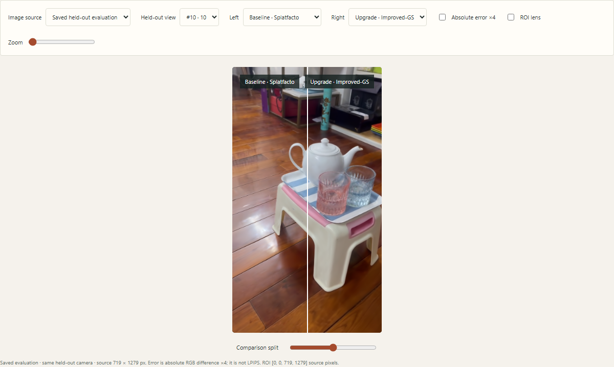

# Photos to 3D · Spatial Studio

Tái dựng cảnh 3D từ ảnh bằng **Nerfacto, Splatfacto và Improved-GS**. Spatial Studio cho phép khám phá 3D, so sánh baseline/upgrade và xem benchmark trên **Tea sets, Bonsai, Room, Garden, Poster**.



## Điểm chính

- Đã hoàn tất baseline và bản Gaussian upgrade cho cả **5 scene**; giữ nguyên model gốc để đối chiếu.
- UI có camera sync, gallery 3D, ảnh GT/baseline/upgrade, wipe, zoom, ROI và benchmark theo thí nghiệm.
- Pipeline native Windows, checkpoint resume, kiểm artifact bằng checksum và giới hạn tài nguyên GPU.

## Kết quả chính

PSNR trung bình trên các held-out views, cùng GT/camera và evaluator RGB8:

| Scene | Splatfacto baseline | Improved-GS |
|---|---:|---:|
| Tea sets | 28.68 dB | **31.73 dB** |
| Bonsai | 31.50 dB | **32.45 dB** |
| Room | 31.66 dB | **32.34 dB** |
| Garden | 26.24 dB | **26.65 dB** |
| Poster | 32.56 dB | **33.74 dB** |

SSIM và LPIPS trung bình cũng cải thiện trên cả năm scene. Tea có thay đổi resolution training nên mức tăng không chỉ do kiến trúc; Poster là ca kiểm tra chuyển giao. Thí nghiệm Room A/B/C riêng cho Nerfacto đạt **30.30 dB native float** khi tắt camera optimizer và appearance embedding (một seed).

Browser còn sai khác ở một số view Room/Poster; Garden chưa đạt mục tiêu 30 FPS. [Số đo và phạm vi thí nghiệm](docs/research/results-2026-11-13.json).

## Chạy project

Dùng **Windows PowerShell tại root repo**; các bước setup/GPU chạy bằng Administrator. Cấu hình đã kiểm chứng: RTX A4500 Laptop 16 GB. Dataset, checkpoints và full reports không nằm trong Git.

### Máy đã có kết quả

```powershell
Set-ExecutionPolicy -Scope Process Bypass
.\Invoke-Topic16.ps1 ui
```

Mở URL launcher thông báo, mặc định **http://127.0.0.1:7016**. Chọn scene → **Bản hiển thị: Compare** → **Improved-GS · selected final · 30,000 steps**.

Khi cần cập nhật catalog/build hoặc dừng UI:

```powershell
.\Invoke-Topic16.ps1 ui-prepare
.\Invoke-Topic16.ps1 ui-build
.\Invoke-Topic16.ps1 ui
# Dừng server:
.\Invoke-Topic16.ps1 ui-stop
```

### Máy mới

Cần có Git trước khi clone:

```powershell
git clone https://github.com/HelcurtLordno1/Photos_to_3d-NeRF-and-guassian-splatting.git
Set-Location Photos_to_3d-NeRF-and-guassian-splatting
Set-ExecutionPolicy -Scope Process Bypass
.\scripts\Install-HostTools.ps1 -InstallBuildTools
```

Mở lại PowerShell Administrator tại repo, rồi chạy:

```powershell
Set-ExecutionPolicy -Scope Process Bypass
.\Invoke-Topic16.ps1 setup-all
.\Invoke-Topic16.ps1 ui-setup
```

Để có reconstruction thật, cần chạy pipeline hoặc nhận đủ artifacts đã xác thực. Sau khi chuẩn bị và duyệt dữ liệu Tea theo [runbook](setup_full_command.md), chạy baseline:

```powershell
.\scripts\Run-Research.ps1 -SessionDirectory '.\artifacts\logs\research\topic16-full' -CustomScene tea_sets_2
```

Hoàn tất training rồi chạy `ui-prepare`, `ui-build`, `ui` như trên. Nhánh Improved-GS có runtime/protocol riêng trong `upgrade/`; xem [UI và cách sử dụng](UI_design/README.md), [kế hoạch Gaussian](docs/plans/final-quality-campaign.md) và [lệnh đầy đủ, setup dữ liệu, stop/resume](setup_full_command.md).

**Nhóm:** Khổng Gia Minh · Nguyễn Phú Nam · Hồ Đức Mạnh · Đinh Nam Khánh.
